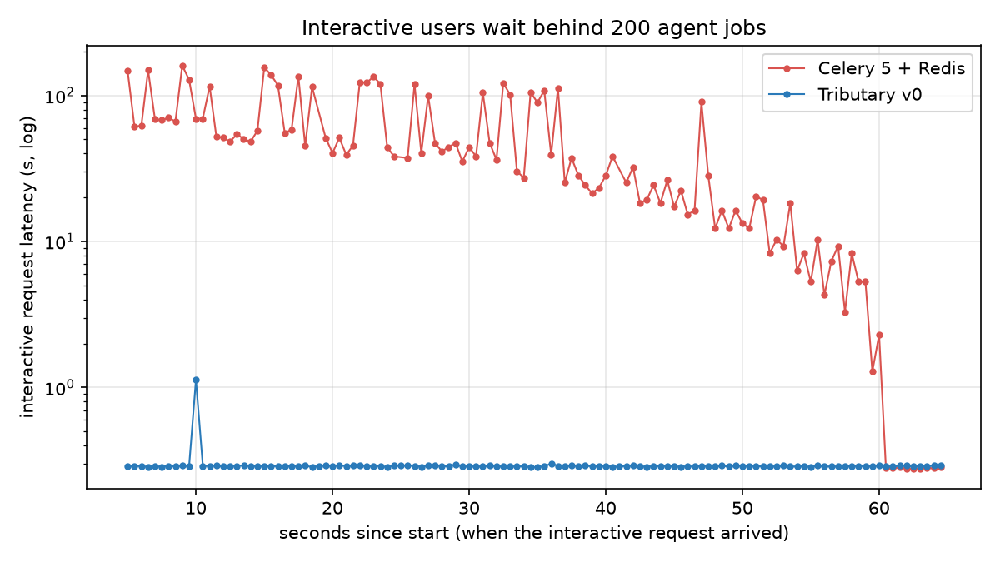

# Tributary

**The job queue that understands LLMs.** Agent and LLM jobs on Tributary stop melting under rate
limits, stop paying twice for retries, and stop starving interactive users.

Same workload, same provider limits: 200 agent jobs and 120 interactive requests against a model
API limited to 120,000 tokens per minute.

| | Celery 5 + Redis | Tributary v0 |
|---|---|---|
| 429 responses from the provider | 1,807 | **0** |
| Paid calls made twice | 47 | **0** |
| Interactive latency, p95 | 134 s | **0.3 s** |
| Jobs completed | 308 of 320 | **320 of 320** |



Tributary trades some batch throughput for this. The benchmark's pool keeps 20% of the provider
budget for interactive users (`headroom=0.2`; the default is 0), so batch work finished later: all
320 jobs in 222 s, against 178 s for the 308 jobs Celery completed before giving up on 12. The benchmark, every configuration we ran, and its limits are in
[demo/README.md](demo/README.md). Rerun it with `demo/run.sh`.

## Why

A plain job queue counts messages. Model providers count tokens and money, so:

- **Bursts of jobs hit 429s.** Retries burn their attempts, and jobs give up.
- **Retries pay twice.** A job that crashes after two model calls starts again from the first.
- **Batch work starves users.** A user's request waits behind a thousand background jobs.
- **Old runs keep going.** When a user sends a new message, the run for their old one is still
  using tokens.

## What Tributary does

- **Quota pools in tokens or money.** Each job carries an estimate. Workers report actual usage on
  ack, and the pool corrects itself and learns how accurate the estimates are. Window mode applies
  the provider's own rolling 60-second rule.
- **Provider-aware retries.** Raising `Throttled(retry_after)` pauses delivery for that long
  without using up an attempt. `QuotaExhausted` pauses the pool until you resume it. `Permanent`
  sends the job straight to the dead-letter topic.
- **Priority and fairness.** Interactive, standard and background bands are served by weight, with
  ageing so nothing waits forever. Headroom keeps part of the budget for the top band, and pacing
  spreads batch work across the minute. Within a band, tenants take turns.
- **Supersede and cancel.** With the `agent-session` profile, a user's new message marks the run
  for their previous one as superseded, and `job.cancelled` turns true so the worker can stop.
- **Resume, don't restart.** `job.save_progress(...)` stores a checkpoint with the lease, and a
  retry starts where the last attempt stopped. `job.effect_key(step)` gives a stable idempotency
  key for any external call.
- **The basics, done safely.** Every produce, lease, ack and nack is synced to disk before the
  response. A test kills the server 50 times with `kill -9` under load and checks that no
  acknowledged message is lost or redelivered after its ack; power loss is not tested yet. It also has leases, back-off, crash-loop detection, dead
  letters with requeue, per-key ordering, delayed messages, idempotent produce and Prometheus
  metrics.

## Quickstart

Build and start a throwaway server (needs Go 1.22+):

```bash
git clone https://github.com/nileshkr9919/tributary && cd tributary
make build
bin/trib dev            # listens on 127.0.0.1:7070, data deleted on exit
```

In another terminal, with the Python client (standard library only):

```bash
pip install ./clients/python
```

```python
from tributary import Client, Worker, Throttled

c = Client("http://127.0.0.1:7070")
c.create_topic("llm", exist_ok=True)
c.create_pool("openai", per_minute=120_000, mode="window", headroom=0.2, pace="10s", exist_ok=True)
c.create_subscription("agents", "llm", profile="llm-requests", params={"pool": "openai"}, exist_ok=True)

c.publish("llm", {"prompt": "hello"}, priority="interactive",
          headers={"tenant": "acme", "x-est-tokens": "800"})

def handle(job):
    step = (job.checkpoint or {}).get("step", 0)
    # call your model here; on a 429:  raise Throttled(retry_after=seconds, scope="subscription")
    job.report_usage(tokens=750)
    job.save_progress({"step": step + 1})
    print("done", job.payload)

Worker(c, "agents", handle, concurrency=20).run()
```

## Profiles

A subscription is created from a profile and can override any setting.

| Profile | For |
|---|---|
| `work-queue` | Plain background jobs: at-least-once, retries with back-off, dead letters |
| `llm-requests` | Model calls: priority bands, fairness by `tenant`, a quota pool (required `pool` parameter) |
| `agent-session` | One run per user or conversation key: per-key ordering, supersede, 5-minute lease extendable to 6 hours |

## HTTP API

Everything the Python client does is plain HTTP and JSON. You can produce and consume with `curl`:

```bash
curl -s -XPOST localhost:7070/v1/topics -d '{"name":"jobs"}'
curl -s -XPOST localhost:7070/v1/subscriptions -d '{"name":"w","topic":"jobs"}'
curl -s -XPOST localhost:7070/v1/topics/jobs/messages -d '{"messages":[{"payload":{"n":1}}]}'
curl -s -XPOST localhost:7070/v1/subscriptions/w/receive -d '{"member":"me","max":10}'
```

The routes are listed in [the v0 spec](docs/superpowers/specs/2026-10-19-tributary-v0-launch.md#http-api).
Metrics are at `/metrics` and health at `/healthz`.

## Status: v0

- **Single node.** Replication is designed but not built.
- **The on-disk format is not stable**, so upgrades may need a fresh data directory.
- **No authentication.** The server listens on 127.0.0.1 unless you pass `--listen`.
- **Old messages are never deleted**, so disk use grows on long runs.
- **Python only for now.** There is no Go or TypeScript client yet, though the HTTP API works from
  anything.
- **The benchmark uses a mock provider**, and each configuration was run once.

## Design and research

Tributary v0 is the first slice of a larger design. That design is one replicated log serving
queues, streams and pub-sub, with every behaviour chosen per subscription through profiles:

- [the platform design](docs/superpowers/specs/2026-10-19-unified-messaging-platform-design.md)
- [the research behind it](docs/research/README.md): ten reports on Kafka, Pulsar, RabbitMQ, NATS,
  cloud queues, the new Kafka-compatible systems, Postgres queues, and AI workloads

## License

Apache-2.0
